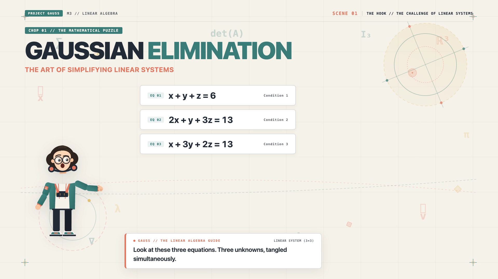
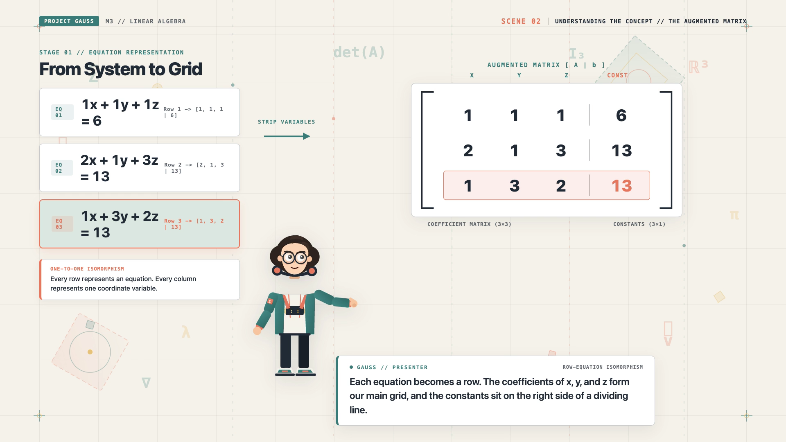
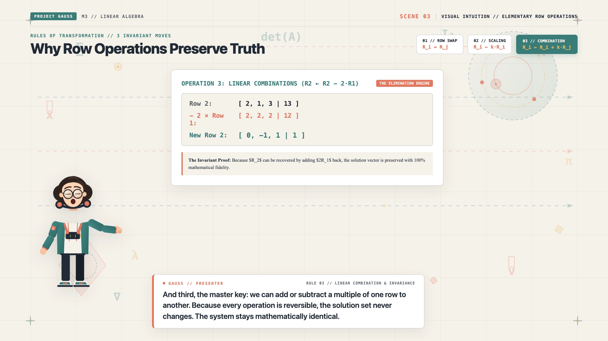
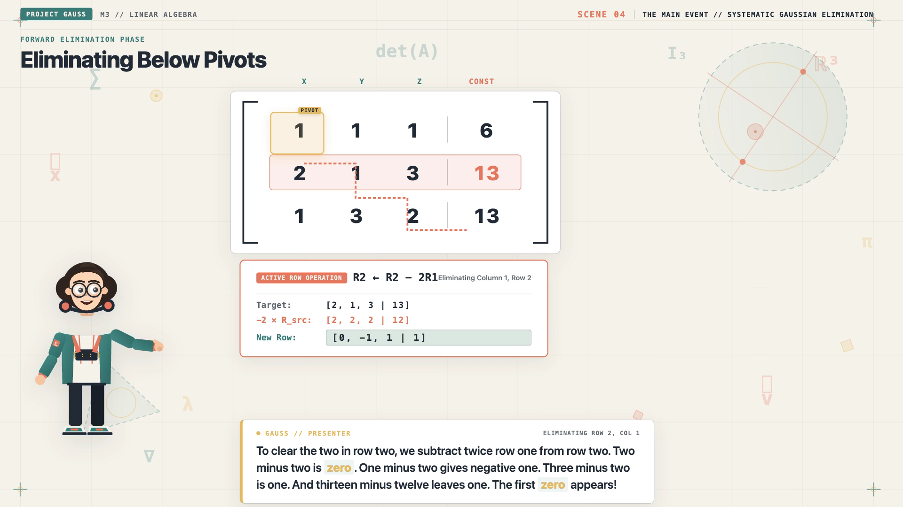
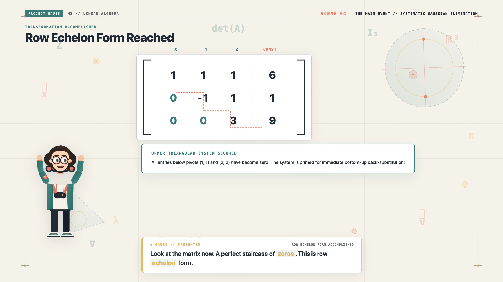
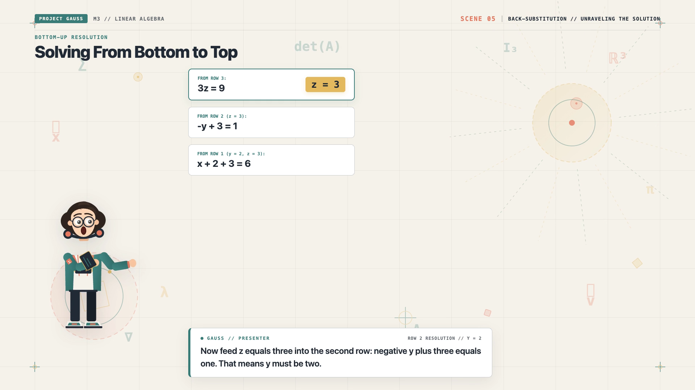

<div align="center">

# PROJECT GAUSS

**Making Linear Algebra Come Alive.**

A cinematic, animated educational film that explains Gaussian Elimination through mathematical storytelling, expressive character animation, and carefully synchronized narration.


<br />

[](https://drive.google.com/drive/folders/1R9Bw_p-nDO2-f-wGFq2Ik1ZIvWmam6tE)

*Click the preview above to open the complete film and production assets on Google Drive.*

</div>

---

## Visual Showcase

Every frame of **Project GAUSS** is rendered programmatically at **1920×1080 (30 fps)** using a Warm Editorial design system (`#F5F2EA` Warm Paper, `#202A35` Midnight Ink, `#397C78` Deep Teal, `#E4775E` Terracotta, `#E4B95F` Muted Saffron, and `#DCE8E1` Sage Mist).

| Scene 02 — Augmented Matrix | Scene 03 — Elementary Row Operations |
| :---: | :---: |
|  |  |
| *Stripping variables to form the isomorphic `[A \| b]` array* | *Demonstrating reversible linear combinations (`R2 ← R2 - 2·R1`)* |

| Scene 04 — Forward Elimination | Scene 04 — Row Echelon Form |
| :---: | :---: |
|  |  |
| *Live pivot targeting and row-operation arithmetic tray* | *The upper-triangular staircase of zeros locked into place* |

<div align="center">

| Scene 05 — Back-Substitution & Solution Cascade |
| :---: |
|  |
| *Unrolling the triangular system bottom-up: `z = 3` → `y = 2` → `x = 1`* |

</div>

---

## Project Overview

**Project GAUSS** transforms an abstract linear algebra procedure into a structured, visual narrative. Instead of treating Gaussian Elimination as rote symbol manipulation, the film guides viewers through *why* each step preserves the underlying solution set.

### The Learning Journey

1. **Understanding the System** — Introducing three coupled linear equations in three unknowns (`x`, `y`, `z`) and why naive substitution quickly becomes tangled.
2. **Converting to an Augmented Matrix** — Stripping variable labels to represent the system compactly as `[A | b]`.
3. **Learning Elementary Row Operations** — Exploring the three truth-preserving moves: row swapping, non-zero scalar multiplication, and adding a multiple of one row to another.
4. **Performing Gaussian Elimination** — Using pivot entries to systematically clear coefficients below the main diagonal.
5. **Reaching Row Echelon Form** — Arriving at a clean upper-triangular staircase of zeros.
6. **Applying Back-Substitution** — Solving from the bottom row upward (`z → y → x`).
7. **Verifying the Final Solution** — Checking the resulting vector against all three original equations.

---

## Mathematical Example

The film walks through the exact $3 \times 3$ linear system below without shortcuts or skipped arithmetic:

$$
\begin{aligned}
x + y + z &= 6 \\
2x + y + 3z &= 13 \\
x + 3y + 2z &= 13
\end{aligned}
$$

Transforming the system into its augmented matrix $[A \mid \mathbf{b}]$ and applying forward elimination ($R_2 \leftarrow R_2 - 2R_1$, $R_3 \leftarrow R_3 - R_1$, and $R_3 \leftarrow R_3 + 2R_2$) yields Row Echelon Form:

$$
\left[\begin{array}{ccc|c}
1 & 1 & 1 & 6 \\
2 & 1 & 3 & 13 \\
1 & 3 & 2 & 13
\end{array}\right]
\;\longrightarrow\;
\left[\begin{array}{ccc|c}
1 & 1 & 1 & 6 \\
0 & -1 & 1 & 1 \\
0 & 0 & 3 & 9
\end{array}\right]
$$

Back-substitution from the bottom row ($3z = 9 \implies z = 3$) through Row 2 ($-y + 3 = 1 \implies y = 2$) and Row 1 ($x + 2 + 3 = 6 \implies x = 1$) produces the unique verified solution:

$$
\boxed{x = 1,\quad y = 2,\quad z = 3}
$$

---

## Technology Stack

| Layer | Technology | Role in Production |
| :--- | :--- | :--- |
| **Video Engine** | **Remotion 4.0** (`remotion`, `@remotion/cli`, `@remotion/bundler`, `@remotion/shapes`) | Frame-accurate React composition, spring physics, and 1080p H.264 rendering |
| **UI & Animation** | **React 19** & **TypeScript 5.7** | Modular scene components, SVG vector rigging, and strictly typed state |
| **Audio Synthesis** | **Python 3** (`scripts/generate_cinematic_score.py`) | Procedural generation of the 236.5s D Dorian / F Major documentary score |
| **Rendering Config** | **H.264 / CRF 18** (`remotion.config.ts`) | High-bitrate 1920×1080, 30 fps master video encoding |

---

## Technical Architecture

Project GAUSS is structured as a deterministic, timeline-driven Remotion application synchronized to a single master audio clock (`final_master_soundtrack.wav`, 7,095 frames at 30 fps):

- **Scene-Based Master Assembly (`src/Root.tsx`)** — `MasterFilm` sequences six independent scene compositions (`Scene01_Hook` through `Scene06_Takeaway`) using Remotion's `<Series>`, alongside standalone scene compositions (`Scene01-Hook` through `Scene06-Takeaway`) for isolated review and rendering.
- **Reusable Mathematical Components (`src/components/`)** —
  - `Matrix.tsx` & `MatrixBracket.tsx`: Animated $3 \times 4$ augmented matrices with column headers (`x`, `y`, `z`, `const`), active row highlights, and zero-staircase indicators.
  - `PivotHighlight.tsx`: Spring-animated pivot callout boxes with subtle breathing pulses.
  - `RowOperationTray.tsx`: Live arithmetic breakdown cards showing target row, scaled source row, and resulting row.
  - `EquationCard.tsx`: Color-coded equation cards for system setup and verification.
- **Vector-Rigged Presenter (`src/character/Gauss.tsx`, `GaussRig.tsx`)** — A programmatic SVG/CSS character rig for **GAUSS** supporting multiple poses (`idle`, `explaining`, `pointing`, `solving`, `celebrating`, `thinking`), emotional expressions (`curious`, `thinking`, `aha`, `confident`, `proud`, etc.), multi-directional gaze, and frame-synchronized lip-flap animation.
- **Living Background & Editorial Chrome (`LivingBackground.tsx`, `BackgroundGrid.tsx`, `HeaderBar.tsx`)** — Thematic ambient motion layers with drifting mathematical symbols, geometric compass rings, crosshairs, and a 12-column Swiss grid (`src/styles/grid.ts`).
- **Synchronized Captions & Audio (`DialogueCaption.tsx`, `scripts/generate_cinematic_score.py`)** — Documentary-style bottom caption cards with automated mathematical keyword highlighting, paired with a procedurally synthesized minimalist score ducked beneath the voiceover.

---

## Project Structure

```text
.
├── docs/
│   ├── assets/                     # Hero thumbnail & verified 1080p scene stills
│   ├── FINAL_AUDIO_TIMING_MAP.md   # Frame & millisecond alignment across 67 audio chunks
│   ├── FINAL_SYNC_QA_REPORT.md     # Full mathematical, visual, and audio QA audit
│   ├── MASTER_VOICEOVER_SCRIPT.md  # Complete narration script
│   ├── design-system.md            # Warm Editorial color, typography, and grid spec
│   ├── mathematical-verification.md# Step-by-step linear algebra proof
│   └── storyboard.md               # Scene-by-scene visual storyboard
├── public/
│   └── assets/gauss/               # Character reference sheets, poses, and expressions
├── scripts/
│   └── generate_cinematic_score.py # Procedural D Dorian / F Major soundtrack generator
├── src/
│   ├── character/                  # Gauss.tsx & GaussRig.tsx vector character system
│   ├── components/                 # Matrix, RowOperationTray, PivotHighlight, Captions, etc.
│   ├── scenes/                     # Scene01_Hook through Scene06_Takeaway
│   ├── styles/                     # colors.ts, typography.ts, grid.ts
│   ├── Root.tsx                    # MasterFilm & standalone scene compositions
│   └── index.ts                    # Remotion entry point
├── package.json                    # Dependencies and Remotion CLI scripts
├── remotion.config.ts              # H.264 / CRF 18 render settings
└── tsconfig.json                   # TypeScript configuration
```

---

## Access the Complete Project

Final rendered 1080p MP4 deliverables and full-resolution stereo audio masters are hosted externally to keep the Git repository lightweight and focused on source code and documentation:

[**Google Drive — Complete Project Assets & Final Video**](https://drive.google.com/drive/folders/1R9Bw_p-nDO2-f-wGFq2Ik1ZIvWmam6tE)

---

## Production Highlights

- **Cinematic Educational Storytelling** — Six cohesive scenes (`03:56.50` total runtime) taking the viewer from algebraic intuition to formal verification.
- **Mathematical Precision** — Every row operation, pivot highlight, and back-substitution step is verified against the $3 \times 3$ system.
- **Custom Animated Presenter** — Vector-rigged GAUSS character with dynamic expressions, gaze tracking, and speaking animation.
- **Synchronized Narration & Captions** — Frame-calibrated dialogue captions with inline mathematical term highlighting.
- **Editorial Visual Design** — High-contrast Warm Editorial palette built on a 12-column Swiss layout grid (`src/styles/`).
- **Original Procedural Score** — Custom Python-synthesized minimalist documentary score (*"The Architecture of Truth"*) in D Dorian / F Major.

---

## Running the Project

### Prerequisites

- **Node.js** (v18+ recommended) and **npm**
- **Python 3** (optional, for regenerating the background score via `scripts/generate_cinematic_score.py`)
- **Master Audio File**: Place `final_master_soundtrack.wav` (available in the Google Drive assets folder) inside `public/` before rendering `ProjectGauss-Final`.

### Installation

```bash
npm install
```

### Interactive Remotion Studio

Launch the interactive timeline preview in your browser:

```bash
npm start
```

### Rendering Commands

Render the complete master film (`ProjectGauss-Final`, 7,095 frames @ 1920×1080, 30 fps):

```bash
npx remotion render src/index.ts ProjectGauss-Final renders/final/PROJECT_GAUSS_FINAL.mp4
```

Additional scripts defined in `package.json`:

```bash
# Render Scene 04 prototype composition
npm run render:scene4

# Capture a single still frame from Scene 04
npm run still:scene4
```

---

## Credits

- **Project**: Project GAUSS — *Gaussian Elimination: The Art of Simplifying Linear Systems* (Linear Algebra M3)
- **Frameworks & Libraries**: Built with [Remotion](https://www.remotion.dev/) (MIT License) and [React](https://react.dev/) (MIT License). See [docs/credits-and-disclosure.md](docs/credits-and-disclosure.md) for full production attributions and AI/automation transparency notes.
- **Licensing**: No standalone repository license file has been established; all rights remain with the project author unless otherwise specified.
